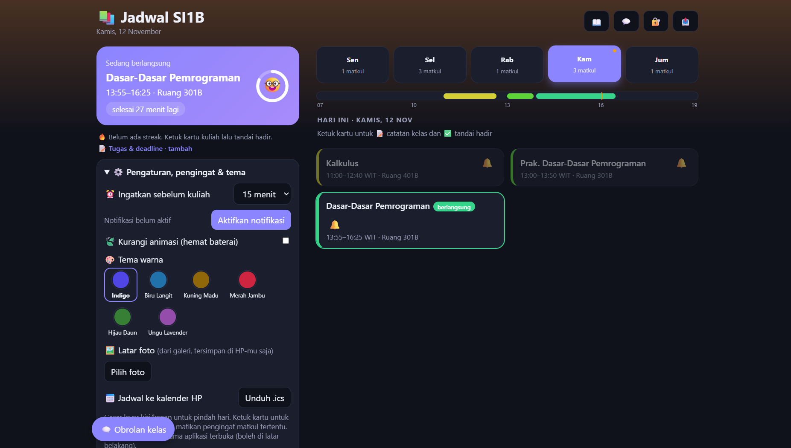
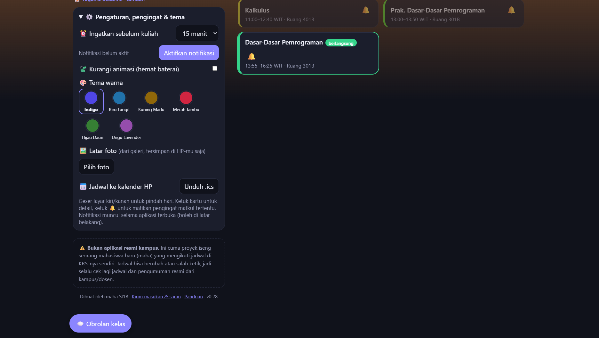

# 📚 Pengingat Kuliah SI1B

Aplikasi web untuk melihat jadwal kuliah, mendapat pengingat sebelum kelas dimulai, dan mencatat tugas beserta deadline-nya. Dibuat untuk kelas **SI1B (Sistem Informasi, semester 1)**.

> ⚠️ Aplikasi ini **tidak resmi** dan bukan buatan kampus. Jadwal diambil dari KRS. Jika ada perbedaan dengan jadwal resmi, ikuti yang dari kampus.

🔗 **Demo:** `https://rafly-ramadhan-dev.github.io/pengingat-kuliah/`

   
   

## ✨ Fitur

**Untuk mahasiswa**
- Jadwal kuliah per hari dengan penanda kelas yang sedang berlangsung dan hitung mundur ke kelas berikutnya
- Pengingat notifikasi sebelum kelas dimulai
- Pencatat kehadiran dengan *streak* kuliah berturut-turut
- Tugas dan deadline per mata kuliah, dengan pengingat 24 jam dan 1 jam sebelum batas waktu
- Ekspor jadwal ke kalender HP (`.ics`)
- Catatan dan obrolan per mata kuliah
- Pilihan tema warna dan latar foto dari galeri sendiri
- Bisa dipasang di layar utama HP (PWA) dan tetap terbuka saat offline

**Untuk admin**
- Mengubah, menambah, dan menghapus kelas langsung dari aplikasi
- Menandai libur, dosen tidak masuk, atau perubahan jam kuliah
- Pengumuman berbentuk pop-up, log kunjungan, dan mode maintenance

## 🛠️ Teknologi

| Bagian | Teknologi |
| --- | --- |
| Tampilan dan logika | HTML, CSS, dan JavaScript murni (satu file `index.html`) |
| Aplikasi instalasi dan offline | PWA: `manifest.json` dan Service Worker (`sw.js`) |
| Backend | Google Apps Script dengan Google Sheets sebagai database |
| Penyimpanan di perangkat | `localStorage` (tugas, kehadiran, tema) |

## 📁 Struktur proyek

```
pengingat-kuliah/
├── index.html               # Aplikasi utama (UI dan logika)
├── manifest.json            # Konfigurasi PWA
├── sw.js                    # Service Worker (cache untuk mode offline)
├── icon.svg                 # Ikon aplikasi
└── backend-apps-script.gs   # Backend untuk Google Apps Script
```

## 🚀 Menjalankan secara lokal

1. Clone repositori ini:
   ```bash
   git clone https://github.com/rafly-ramadhan-dev/pengingat-kuliah.git
   cd pengingat-kuliah
   ```
2. Jalankan server lokal (Service Worker tidak jalan jika file dibuka langsung):
   ```bash
   python -m http.server 8000
   ```
3. Buka `http://localhost:8000` di browser.

Fitur yang tersimpan di perangkat (jadwal, tugas, kehadiran, tema) sudah bisa dipakai tanpa backend.

## ☁️ Menyiapkan backend (opsional)

Fitur bersama seperti pengumuman, obrolan, catatan, dan perubahan jadwal oleh admin membutuhkan backend.

1. Buat Google Sheet baru, lalu buka **Extensions → Apps Script**.
2. Tempel isi `backend-apps-script.gs`.
3. Ganti nilai `PIN_UTAMA` dengan PIN rahasia milikmu.
4. Klik **Deploy → New deployment → Web app**, lalu atur akses sesuai kebutuhan.
5. Salin URL hasil deploy dan tempel ke konstanta `API` di `index.html`.

> 🔒 **Jangan pernah meng-commit PIN asli ke repositori publik.** Simpan PIN hanya di Apps Script milikmu.

## 🌐 Deploy ke GitHub Pages

1. Buka **Settings → Pages** di repositori ini.
2. Pada *Source*, pilih branch `main` dan folder `/ (root)`.
3. Simpan. Aplikasi akan tersedia di `https://rafly-ramadhan-dev.github.io/pengingat-kuliah/`.

## 🤖 Catatan pembuatan

Proyek ini dibuat dengan bantuan AI (**Claude**). Saya berperan sebagai pengarah: menentukan kebutuhan dan fitur, memberi arahan, menguji hasilnya, dan memperbaikinya lewat banyak iterasi (sekarang sudah versi 0.28). Lewat proyek ini saya belajar cara kerja aplikasi web, PWA, dan backend sederhana dengan Google Apps Script.

## 📌 Rencana pengembangan

- [ ] Dukungan untuk kelas lain selain SI1B
- [ ] Mode gelap otomatis
- [ ] Sinkronisasi tugas antar perangkat

## 👤 Pembuat

**Rafly Ramadhan**, mahasiswa S1 Sistem Informasi
GitHub: [@rafly-ramadhan-dev](https://github.com/rafly-ramadhan-dev)
